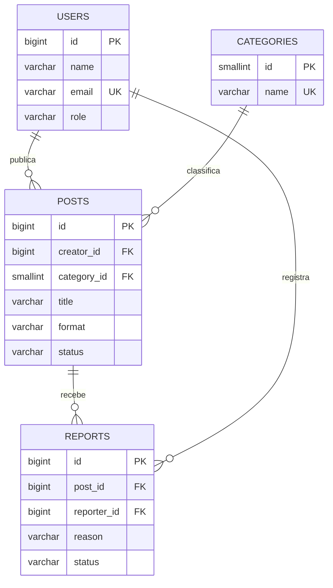

# Banco de dados do ComedyHub

O modelo relacional atende ao público-alvo da plataforma: consumidores descobrem conteúdo, criadores publicam e moderadores analisam denúncias.

## Modelo de dados



## Como executar com PostgreSQL

```bash
createdb comedyhub
psql -d comedyhub -f database/schema.sql
psql -d comedyhub -f database/seed.sql
psql -d comedyhub -f database/operations.sql
```

`schema.sql` contém entidades, relacionamentos, chaves, restrições e índices. `seed.sql` insere dados de exemplo. `operations.sql` documenta inserção, consulta, atualização e remoção.
